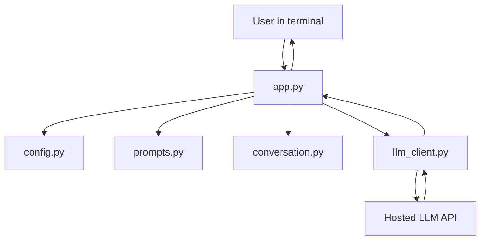

# Building Your First LLM Application with Python

A terminal-based AI question-answering assistant built with Python and the OpenAI SDK. This project demonstrates configuration, prompt construction, model API calls, bounded conversation history, error handling, automated tests, and CI.

> **Important:** API usage may incur charges. The model configured in `.env.example` is an example; confirm that it is available to your API account.

## Features

- Reads configuration from environment variables and a local `.env` file.
- Validates missing or placeholder API keys before starting.
- Sends prompts to an LLM through the OpenAI Python SDK.
- Maintains bounded conversation history for a terminal session.
- Handles common authentication, rate-limit, timeout, and API errors.
- Includes unit tests and a GitHub Actions workflow.
- Keeps secrets and generated Python files out of version control.

## Architecture



## Project structure

```text
first-llm-app-python/
├── src/llm_app/
│   ├── __init__.py
│   ├── app.py
│   ├── config.py
│   ├── conversation.py
│   ├── llm_client.py
│   └── prompts.py
├── tests/
├── examples/sample_questions.txt
├── .env.example
├── .github/workflows/python-tests.yml
├── .gitignore
├── LICENSE
├── pyproject.toml
└── requirements.txt
```

## Prerequisites

- Python 3.11 or later
- An API key for the configured LLM provider

## 1. Create and activate a virtual environment

### Windows PowerShell

```powershell
py -3.11 -m venv .venv
.\.venv\Scripts\Activate.ps1
```

If PowerShell blocks activation, use Command Prompt:

```bat
.venv\Scripts\activate.bat
```

### macOS / Linux

```bash
python3 -m venv .venv
source .venv/bin/activate
```

## 2. Install dependencies

```bash
python -m pip install --upgrade pip
pip install -r requirements.txt
pip install -e .
```

## 3. Configure your API key

Copy `.env.example` to `.env` and edit it with a real API key:

```dotenv
OPENAI_API_KEY=put_your_real_api_key_here
OPENAI_MODEL=gpt-4o-mini
OPENAI_TIMEOUT_SECONDS=30
```

Never commit `.env` or place your API key in source code, screenshots, blog posts, or logs. Commit only `.env.example`, which contains placeholders.

## 4. Run the application

```bash
python -m llm_app.app
```

Exact responses vary by model and prompt.

## 5. Run tests

```bash
pytest -q
```

Tests use mocks for API behavior and should not require a real API key. GitHub Actions runs the test suite on pushes and pull requests.

## How it works

1. `config.py` loads environment variables.
2. `app.py` reads questions from the terminal.
3. `prompts.py` constructs model messages.
4. `conversation.py` retains bounded recent history.
5. `llm_client.py` calls the hosted model and handles common errors.
6. The answer is printed and the turn is retained for the next request.

Conversation history is kept in memory and is lost when the process exits. The model may produce inaccurate answers; validate important output.

## Configuration

| Variable | Purpose | Example/default |
|---|---|---|
| `OPENAI_API_KEY` | API credential | Required |
| `OPENAI_MODEL` | Model identifier | `gpt-4o-mini` |
| `OPENAI_TIMEOUT_SECONDS` | Request timeout | `30` |

## Troubleshooting

- **Missing API key:** ensure `.env` exists and contains a real key.
- **Authentication failure:** verify that the key is active and can use the selected model.
- **Rate limit:** check account limits and retry after an appropriate delay.
- **Timeout:** check connectivity and try a shorter prompt.
- **Import error:** activate the virtual environment, install dependencies, and run `pip install -e .`.

## Production considerations

This is a learning project, not a production-ready service. Before deploying to real users, consider token-budget-aware history truncation, bounded retries with backoff, input/output limits, rate limits, structured logging that protects sensitive data, and monitoring for latency, errors, and token usage. Do not execute model-generated commands or actions without authorization and safeguards.

## Learning roadmap

This repository accompanies the article **“Building Your First LLM Application with Python”** in the *Vikram Tech Lab* AI & GenAI series. Next topics include embeddings, RAG, and vector databases.

## License

See [LICENSE](LICENSE).
